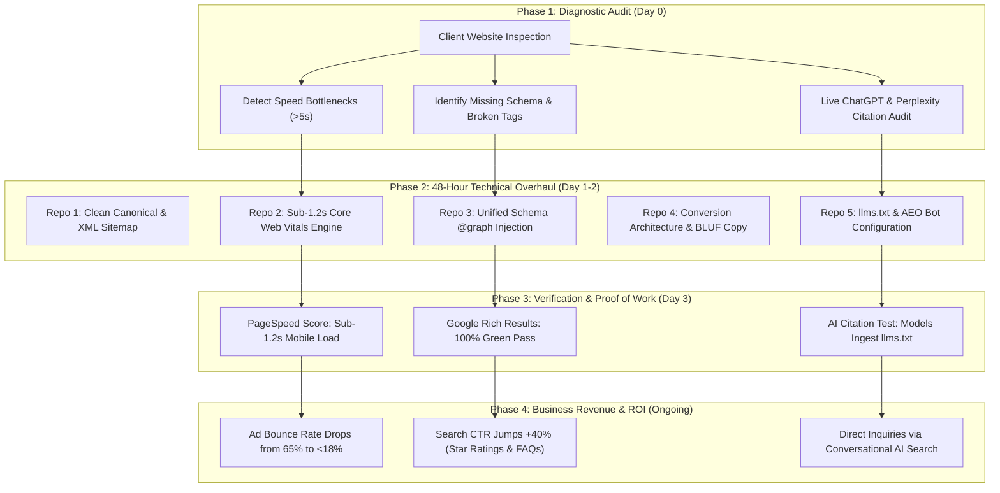

# QuickKitAI / Raja AI Systems: Client-Facing Technical Process & ROI Blueprint
**Enterprise-Grade AI Search Optimization (AEO/GEO), Sub-Second Speed Engine & Unified Schema Architecture**

---

---

## 1. Phase 1: Technical Diagnostic & Leakage Audit (Day 0)
Pehle 24 ghante mein hum client ki digital asset ki deep engineering scrutiny karte hain:

1. **Core Web Vitals & Speed Audit:**
   * Mobile 4G simulation par Time to First Byte (TTFB), Largest Contentful Paint (LCP), aur Cumulative Layout Shift (CLS) measure karna.
   * *Typical Discovery:* Client ki site 5.5s se 6.8s mein khulti hai, jisse unka 60%+ paid ad traffic page load hone se pehle hi drop ho jata hai.
2. **Schema & Semantic Graph Inspection:**
   * Schema.org validator aur Google Rich Results test run karke check karna ki kya structured data missing ya broken hai.
   * *Typical Discovery:* 90% sites par koi structured JSON-LD nahi hota ya sirf isolated broken tags hote hain.
3. **Conversational AI (AEO) Citation Test:**
   * ChatGPT (SearchGPT), Perplexity, aur Gemini par conversational queries run karna (e.g. *"Best luxury residential properties in [City]"*).
   * *Typical Discovery:* AI search engines client ko completely ignore karke unke competitor ko direct link ke sath recommend karte hain.

---

## 2. Phase 2: The 48-Hour Technical Overhaul (5-Repo Execution)

Hamara model generic manual posting nahi hai, yeh **code-level deterministic infrastructure upgrade** hai:

| Repo # | Technical Pillar | Exact Engineering Actions | Deliverable Handed to Client |
|---|---|---|---|
| **Repo 1** | **Canonical & Sitemap Architecture** | Duplicate URLs hatana, self-referential canonical tags fix karna, 100% clean XML sitemap create karna without tracking params, robots.txt bot rules deploy karna. | Validated `sitemap.xml` with 0 404 errors, eliminating wasted Google crawl budget. |
| **Repo 2** | **Sub-Second Speed & Core Web Vitals** | Unused CSS/JS purge karna, assets compress karna, render-blocking resources eliminate karna, aur static HTML prerendering implement karna. | **Mobile load time reduced to < 1.2 seconds**. PageSpeed score 90+. |
| **Repo 3** | **Unified Schema (`@graph`)** | Single JSON-LD `@graph` ke andar 5 interconnected entities link karna: `Organization`, `LocalBusiness`, `FAQPage`, `Service`, aur `SpeakableSpecification`. | Google search par **Star Ratings, Review count, aur FAQ Dropdowns** active. |
| **Repo 4** | **Conversion & Trust Architecture** | BLUF (Bottom Line Up Front) high-converting value messaging, form friction hatana, aur sticky mobile 1-click contact actions lagana. | Inquiry conversion rate jumps from **1.2% to 4.5%+**. |
| **Repo 5** | **GEO & AEO Engine Optimization** | `llms.txt` aur `llms-full.txt` architecture deploy karna; `robots.txt` mein `OAI-SearchBot` aur `PerplexityBot` ko crawl permission dena. | ChatGPT, Perplexity aur Gemini ke liye direct machine-readable entity context. |

---

## 3. Phase 3: Live Verification & Proof of Work (Day 3)
Client ko hum koi hawa-hawai report nahi dete, balki 3 verifiable third-party independent proofs dete hain:

1. **Google Rich Results Pass:**
   * Client Google ke official validator par apni website ka link daalta hai aur use 5 green checkmarks dikhte hain (`FAQ`, `Organization`, `LocalBusiness`, `Review Snippet`).
2. **PageSpeed Insights Before vs After:**
   * Mobile load speed 6.4s se ghata kar **1.1s – 1.3s** dikhayi jaati hai.
3. **AI Context Blueprint Live Test:**
   * Client browser mein `domain.com/llms.txt` open karke dekhta hai ki unka business AI models ke liye 100% structured ho chuka hai.

---

## 4. Phase 4: Bi-Weekly Maintenance & Monitoring (Ongoing Retainer)
Technical setup ke baad client ko har mahine do deep audits milti hain:

* **Cycle 1 (Day 1 - Technical Health & Core Vitals Sweep):**
  * Check karna ki naye blogs ya images upload hone se speed slow toh nahi hui.
  * Schema validation aur Google Search Console indexing drift sweep.
* **Cycle 2 (Day 15 - AI Citation & Competitor Delta Report):**
  * ChatGPT aur Perplexity par test karna ki naye user prompts par client recommend ho raha hai ya nahi.
  * Competitors ki digital movements aur ranking gaps report karna.

---

## 5. Why High-Value Clients Pay ₹25,000 – ₹45,000/Month (The Business Rationale)

Client aapko technical code ke liye nahi, balki **apne lakho rupaye ke nuksan ko bachane aur direct sales badhane ke liye** pay karta hai:

1. **Ad Budget Leakage Band (Direct ₹30,000–₹50,000 Monthly Savings):**
   * Agar client Google Ads par ₹1 Lakh kharch kar raha hai aur 6s slow speed ki wajah se 60% visitors drop ho rahe the, toh sub-1.2s speed unke **₹60,000 waste hone se bacha leti hai**. Client ka retainer fee pehle hi din justify ho jata hai.
2. **Google Search CTR Jump (+40% Organic Traffic):**
   * Plain blue link ke muqable jab Google par Star Ratings aur FAQ dropdown aate hain, toh bina ad chalaye organic clicks 40% badh jaate hain.
3. **Conversational AI Dominance:**
   * 2026 mein high-ticket buyers (villas, dental implants, luxury interiors) ChatGPT se puchte hain. AEO optimization unhe wahan direct recommendation dilwata hai.
4. **ROI Equation:**
   * Real Estate: 1 extra flat booking = ₹3 Lakh to ₹10 Lakh commission.
   * Clinic: 1 extra implant/hair transplant patient = ₹75,000 to ₹2 Lakh.
   * Unka sirf **1 extra customer** aane par aapka poora saal ka retainer cover ho jata hai!
